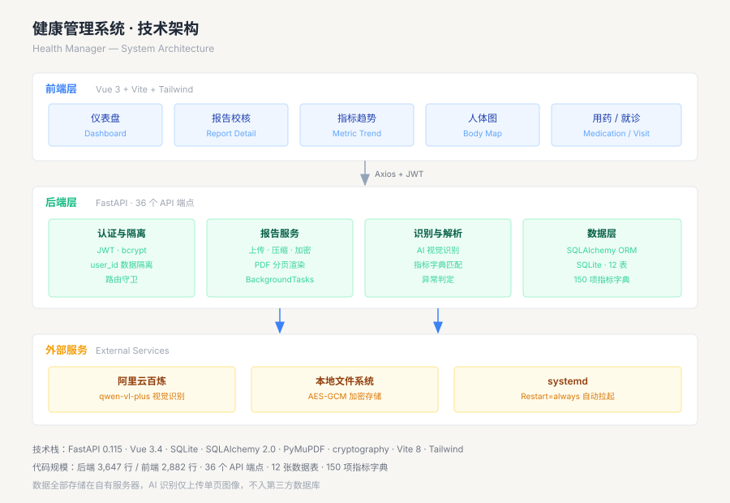
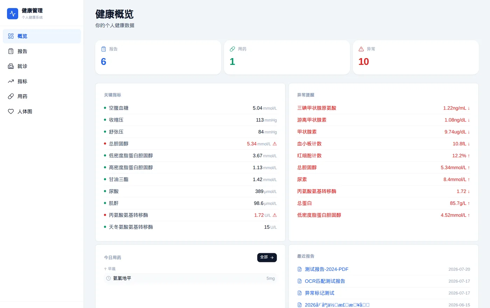
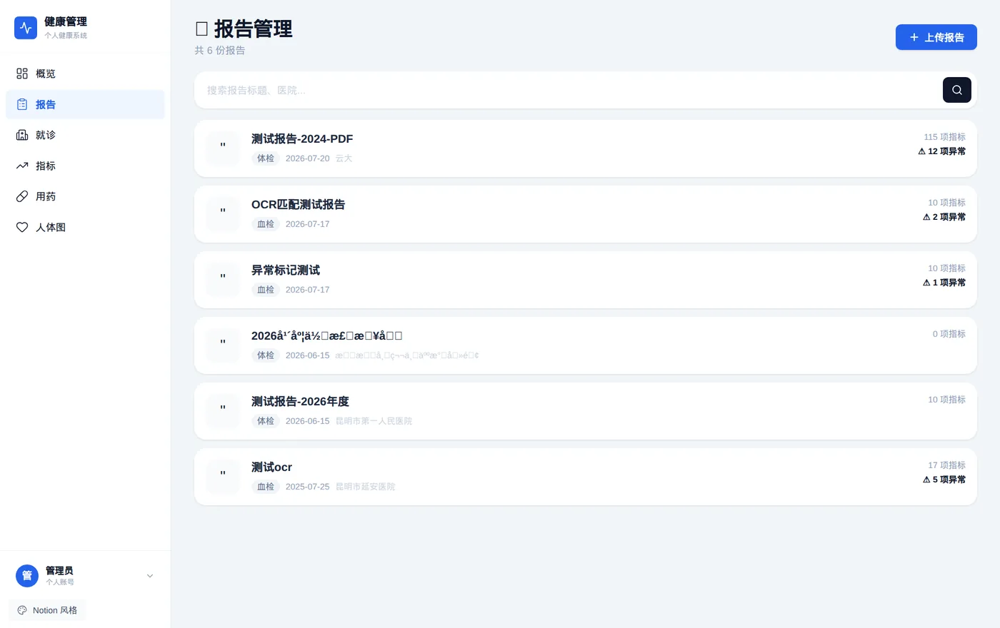
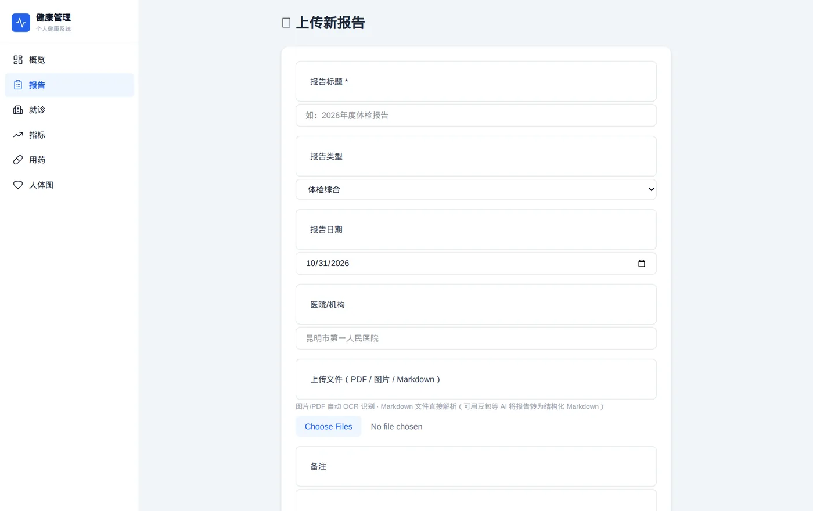
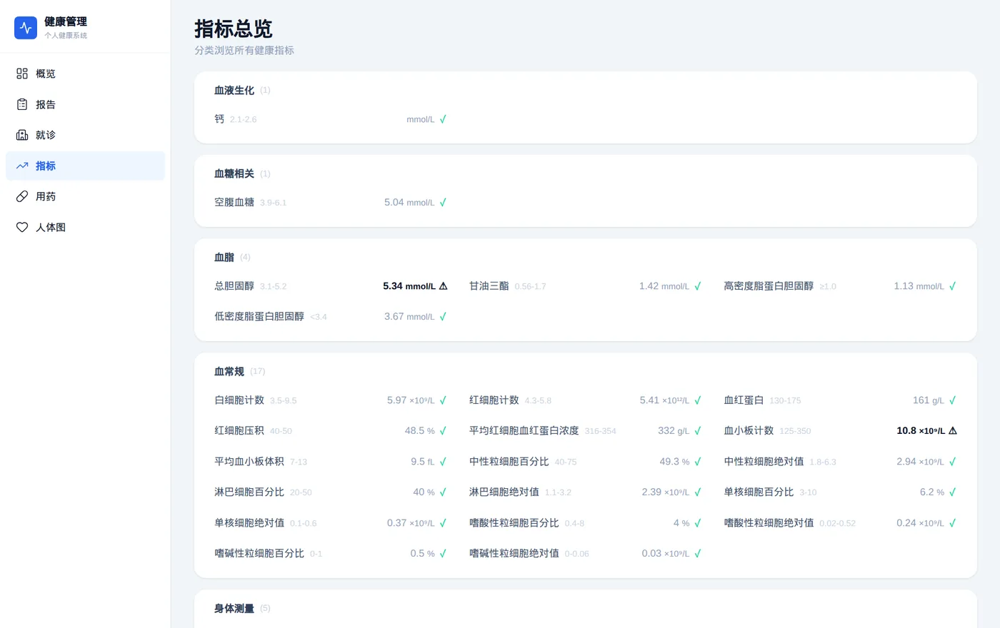
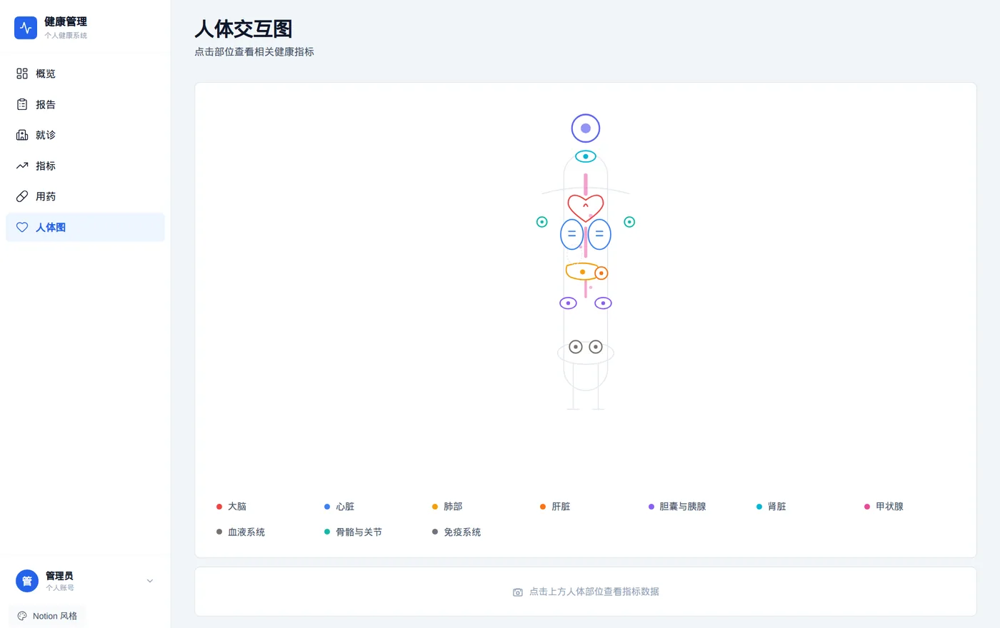

体检报告一年攒一叠，纸质版塞进抽屉就再也没翻过。真正需要对比历年指标的时候，才发现根本找不到趋势——哪年血糖偏高、哪项指标在持续恶化、上次医生开的什么药，全靠记忆。

于是花了几周时间，自己做了一套个人健康管理系统。这篇文章记录从技术选型到踩坑的完整过程，包括中途推翻过的两个方案。



## 一、需求拆解

最初的设想比较简单：上传报告、识别数据、画趋势图。真正动手前把需求拆成了四块：

**数据管理**：上传体检报告（PDF 或照片），识别出结构化指标，能随时按时间线检索。

**数据分析**：单项指标的时间序列对比，以及单次报告的综合解读。

**用药记录**：长期服用的药物、医生处方、服药提醒。

**数据可视化**：按身体部位组织指标，点击某个部位能看到相关数据。

拆完之后意识到有个隐含需求没被写出来：**数据必须是自己的**。体检数据属于高度敏感的个人信息，不能放在别人服务器上，所以整个系统必须跑在自有 VPS 上，数据不出境。

## 二、技术选型

选型的核心约束是 VPS 配置：2 核 CPU、1.9GB 内存。这个配置基本排除了所有重型方案。

| 层 | 选择 | 放弃的方案及原因 |
|---|---|---|
| 后端 | FastAPI | Django 太重，启动就吃掉 200MB+ |
| 数据库 | SQLite | PostgreSQL 常驻进程占 100MB，单用户场景没必要 |
| 前端 | Vue 3 + Vite | Next.js 需要 Node 常驻服务，静态构建更适合 |
| 可视化 | 纯 SVG 手写 | ECharts 单文件 1.1MB，页面加载卡顿 |
| OCR | 云端 AI 视觉 | 本地 Tesseract 中文识别率太低（后面详述）|
| 部署 | systemd | Docker 额外占用 100MB 以上 |

最后一项值得单独说。ECharts 功能确实强，但打包后单个 chunk 就有 1.1MB，在 2 核 VPS 上首屏渲染明显卡。改成手写 SVG 折线图后，整个趋势页只有 6KB——**体积缩小 99.5%**，功能上只放弃了交互缩放这类高级特性，日常看趋势完全够用。

## 三、核心实现

### 3.1 报告识别：从 Tesseract 到 AI 视觉

第一版用 Tesseract 本地识别，想着省钱又隐私。实测结果很难看：

```
原文：总蛋白
识别：总生日

原文：低密度脂蛋白
识别：低密度脂蛋白胆固酵
```

体检报告是表格结构，混排着中文、英文缩写、数字、上下标符号（10⁹/L 这种），Tesseract 对这种版式基本无能为力。做过一轮图像预处理——放大、增强对比度、二值化——识别率从 60% 提到 70%，但关键指标依然错得离谱。

更致命的是"校核成本"：识别错了就得人工逐条改，改完还不如直接手输。**识别本身失去了意义。**

推翻方案，改成调用阿里云百炼的 qwen-vl-plus 视觉模型：

```python
response = requests.post(
    "https://dashscope.aliyuncs.com/compatible-mode/v1/chat/completions",
    headers={"Authorization": f"Bearer {API_KEY}"},
    json={
        "model": "qwen-vl-plus",
        "messages": [{
            "role": "user",
            "content": [
                {"type": "image_url", "image_url": {"url": f"data:image/png;base64,{img_b64}"}},
                {"type": "text", "text": "识别体检报告中的所有项目，返回 JSON"}
            ]
        }]
    }
)
```

同一份报告，识别率从 70% 跳到 95% 以上，参考范围也能一起提取出来。

这里有个取舍要交代清楚：图片会离开服务器。缓解方式是只上传单页图像，不传整份 PDF，且不写入任何第三方数据库。相比"数据完全不出门但识别全是错的"，这个交换是值得的。

### 3.2 PDF 多页处理

体检报告动辄十几页。用 PyMuPDF 把每页渲染成图片再逐页识别：

```python
doc = fitz.open(pdf_path)
for page_num in range(doc.page_count):
    page = doc[page_num]
    pix = page.get_pixmap(matrix=fitz.Matrix(2, 2))  # 2倍分辨率，保证小字清晰
    pix.save(f"/tmp/page_{page_num}.png")
```

`Matrix(2, 2)` 这个 2 倍放大很关键。按原始分辨率导出的话，报告里 8pt 的参考范围数字基本糊成一团。

十二页的报告识别一遍大概 40 秒。这个过程中前端得知道进展，于是踩了下一个坑。

### 3.3 进度反馈：一个 async 引发的阻塞

最初的 OCR 接口是这样写的：

```python
@router.post("/{report_id}/ocr")
async def run_ocr(report_id: int, db: Session = Depends(get_db)):
    result = report_service.run_ocr(db, report_id)  # 同步阻塞 40 秒
    return result
```

前端轮询进度，结果永远是"正在提交"然后直接跳到完成，中间过程一个都看不到。

原因在于：`async def` 的函数跑在事件循环上，里面却调了同步阻塞的 `run_ocr`。这 40 秒里整个事件循环被占死，前端的轮询请求全部排在队列里，等 OCR 结束才一起返回——自然读不到中间进度。

改成后台任务：

```python
@router.post("/{report_id}/ocr")
def run_ocr(report_id: int, background_tasks: BackgroundTasks, db: Session = Depends(get_db)):
    # 先标记状态，立即返回
    for rf in files:
        rf.ocr_status = "processing"
    db.commit()

    background_tasks.add_task(run_ocr_background, report_id)
    return {"message": "OCR 已启动"}
```

配合一个轻量的进度接口，只查状态不加载整个报告：

```python
@router.get("/{report_id}/ocr-progress")
def get_ocr_progress(report_id: int, db: Session = Depends(get_db)):
    files = db.query(ReportFile).filter(...).all()
    if all(f.ocr_status in ("done", "failed") for f in files):
        return {"status": "done", "progress": "识别完成"}
    # 返回 "正在识别第 3/12 页..."
```

前端每 1.5 秒轮询这个接口，按钮上就能实时显示「正在识别第 3/12 页」。

### 3.4 异常判断：报告范围 vs 字典范围

系统内置了 150 项常见指标的参考范围字典，用来做兜底。但这里有个逻辑陷阱：

肌酐的字典默认范围是 35–105 μmol/L，而这次体检报告上写的是 57–97。实测值 98.6，按字典判断是正常，按报告判断是偏高。

最初的代码优先用了字典值：

```python
# 错误的顺序
if def_obj and def_obj.ref_range_low is not None:
    # 用字典的范围判断 —— 忽略了报告里的实际范围
```

体检机构的参考范围会因检测设备、试剂不同而变化，**必须以报告上印的为准**。改成优先解析 AI 提取的范围文本：

```python
# 正确的顺序：先 OCR 实际范围，再兜底字典
ref_text = pm.get("ref_range_text", "")
range_match = re.match(r"([\d.]+)\s*[-~～]\s*([\d.]+)", ref_text)
if range_match:
    low, high = float(range_match.group(1)), float(range_match.group(2))
    # 用报告上的范围判断
elif def_obj:
    low, high = def_obj.ref_range_low, def_obj.ref_range_high  # 兜底
```

改完之后肌酐正确标记为异常。

### 3.5 指标去重：同一个指标的不同叫法

同一份报告里，第 3 页的建议部分写着"低密度脂蛋白（LDL）偏高"，第 7 页的检验数据写着"低密度脂蛋白胆固醇 3.67"。这是同一个指标，但名称不同，如果按字符串去重会被当成两条，一条有值一条没值。

解决方式是去重前先用指标字典规范化：

```python
def normalize(name):
    mdef = match_metric_def(name)   # 查字典，支持别名匹配
    return mdef.name if mdef else name

# 字典里 LDL-C 的 name 是"低密度脂蛋白胆固醇"，alias 包含"低密度脂蛋白"
```

规范化之后两个名称映射到同一个 key，去重时保留有数值的那条。

### 3.6 文件加密：应对"主机不在我这"

VPS 是租的，理论上服务商能接触磁盘。医疗数据的处理方式是上传即加密：

```python
from cryptography.fernet import Fernet

def encrypt_file(path):
    f = Fernet(key)
    data = open(path, "rb").read()
    open(path + ".enc", "wb").write(f.encrypt(data))
    os.remove(path)   # 删掉明文
```

预览时在内存里解密，直接返回响应流，不落盘：

```python
@app.get("/uploads/{report_id}/{filename}")
async def serve_upload(report_id: str, filename: str):
    data = decrypt_file(f"{base}/{filename}.enc")
    return Response(content=data, media_type="image/jpeg")
```

磁盘上永远只有 `.enc` 密文，密钥存在 `.env` 里（该文件已加入 `.gitignore`）。

这里有个细节：**Fernet 的密钥必须是 32 字节的 url-safe base64 编码，也就是 44 个字符**。第一次用 `secrets.token_urlsafe(32)` 生成，出来 43 个字符，服务启动直接报 `ValueError: Fernet key must be 32 url-safe base64-encoded bytes`。正确做法是用 `Fernet.generate_key()`。

## 四、踩坑清单

除了上面展开的几个，还有几处值得一提：

**bcrypt 5.0 与 passlib 不兼容**。装完依赖启动服务，注册接口直接 500：

```
AttributeError: module 'bcrypt' has no attribute '__about__'
```

passlib 1.7.4 读不到 bcrypt 5.0 的版本号。降级到 `bcrypt==4.1.3` 解决。

**前端 inline style 覆盖了 CSS 响应式规则**。手机端概览页内容溢出屏幕，加了 `@media` 查询也不生效。查了半天才反应过来，`style="grid-template-columns: 1fr 1fr"` 是内联样式，优先级高于外部 CSS，连 `!important` 都压不住内联。最后改成用 JS 动态绑定：

```vue
<div :style="{ gridTemplateColumns: isMobile ? '1fr' : '1fr 1fr' }">
```

**进程莫名退出**。用 `nohup` 或后台方式启动的 uvicorn，隔一两天就挂掉，网站打不开。查进程树才发现，这些进程的父进程是启动它的那层 shell，shell 一退出进程就被连带清理。纳入 systemd 之后就稳定了：

```ini
[Service]
Restart=always
RestartSec=5
```

配完之后专门做了次测试：`kill -9` 强杀进程，8 秒内自动拉起，`/api/health` 恢复 200。

**SQLite 加字段没有自动迁移**。加账号系统时给 `reports` 表加了 `user_id` 列，但 SQLAlchemy 的 `create_all()` 只在表不存在时建表，已有表不会自动加列，接口直接报 `no such column`。手工补：

```python
cur.execute('ALTER TABLE reports ADD COLUMN user_id INTEGER REFERENCES users(id)')
```

## 五、部署与运维

系统最终形态是三个 systemd 服务：

| 服务 | 端口 | 说明 |
|---|---|---|
| health-manager | 8000 | 主应用 |
| baby-health | 8001 | 宝宝健康管理（后加）|
| github-webhook | 8080 | 部署钩子 |

内存占用比预想的低：两个 FastAPI 应用加起来约 100MB，剩下 1.6GB 都空着。真正的内存大户是前端构建——首次 `npm run build` 在 2 核机器上跑了 20 多分钟，之后增量构建降到 1-3 秒。

数据备份目前是手动导出 SQLite 文件。加密后的上传文件也在同一目录，打包即可。

## 六、界面

登录页刻意做得简洁，只有账号密码和一句引导：


概览页把最关键的信息放在最上面——最近的异常指标、今日用药、最近报告：



报告列表按时间倒序，每条显示指标数量和异常项数量：



报告详情页是桌面端的重点。左侧原图（PDF 直接翻页预览），右侧识别结果，逐条对比校核：



指标页按身体系统分组，异常项红色标记，点进去是趋势图：



人体图用来按部位定位指标，点击某个部位筛选出相关检查项：



## 七、数据统计

写到这里顺手统计了一下当前规模：

```
后端  FastAPI     3,647 行 Python，37 个文件
前端  Vue 3       2,882 行，19 个组件
API   36 个端点   GET 25 / POST 10 / PUT 5 / DELETE 5
数据  12 张表     150 项指标字典
依赖  bcrypt 4.1.3 · cryptography 49 · PyMuPDF 1.28 · SQLAlchemy 2.0
```

## 八、后续

已经跑起来的部分：报告上传与识别、指标趋势、账号与数据隔离、用药记录、就诊记录、人体图、文件加密。

待做：指标预警推送（指标连续异常时提醒）、数据导出（就诊时给医生看）、移动端体验优化。

这个系列会持续更新，每次功能迭代追加一篇，都归在「健康管理系统」标签下。
